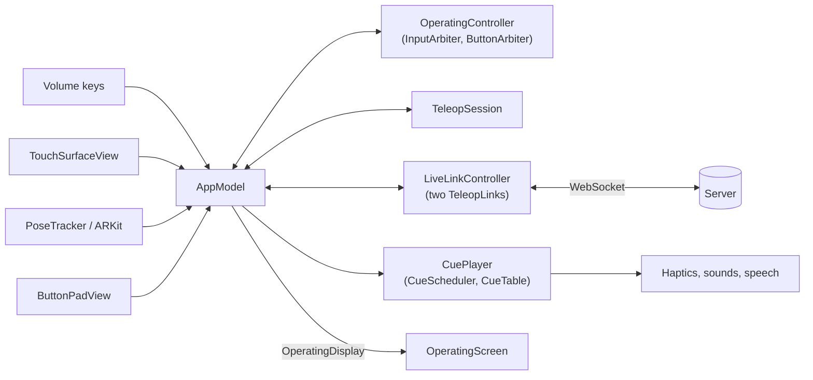

# Architecture

The app turns the iPhone's volume keys, touches on the screen and the phone's own movement into commands for a
robot arm in Isaac Sim, a robot simulator, and turns the server's answers into vibrations, sounds and speech, so
the operator can work mostly without looking at the screen. This note says where each part lives and how the parts
talk. The messages themselves are in `docs/PROTOCOL.md`; the tests are in `docs/TESTING.md`.

A few words recur here. `docs/PROTOCOL.md` explains them in full under "Words used here".

- **Control mode**: screen turns (scheme A), key turns (scheme B) or buttons. The first two, the *phone modes*,
  move the arm with the phone itself; buttons mode uses on-screen buttons.
- **Hold**: a control the server runs from a start to a stop. The app sends a start when it begins, updates or
  keepalives while it lasts, and a stop when it ends. The server runs one hold at a time. Most holds run only while a
  key, a thumb or a button stays down. With the hands-free aids on, an arm hold can also be one nobody keeps down: a
  follow the lock latched, or a move to a point tapped on the guide. The input rules own every hold either way
  ("The hands-free aids" below).
- **Hands-free aids**: lock, tap-to-go and the guide's additions, all turned on and off by one master switch on
  the aids' page, which the Aids button in the Settings header opens. With the switch off the app behaves as version
  1.0.1 did.
- **Final ack**: the server's answer to a start once the hold it started has really ended. A new start or a reset
  waits for it, at most 800 ms.
- **Probe**: the `test` message the app sends twice a second; its echo times the round trip and shows the link is
  alive.
- **Resync**: during a long arm hold, ending the hold on the server and starting a new one from where the arm got
  to, so the server's target never runs too far ahead of the arm.
- **Take**: one attempt recorded by the server's recorder; it is kept as a demonstration if it ends in success.
- **Stop exits**: the ways out of an emergency stop that the screen offers: reset the scene, or release the stop
  and keep the scene.

## The layers

| Layer | Where | What it may use | Built and tested by |
|---|---|---|---|
| Core | `Packages/TeleopCore/Sources/TeleopCore` | Foundation and `simd` only: no UI, no sockets, no clock | `swift test` |
| Server model | `Packages/TeleopCore/Sources/TeleopServerModel` | Foundation only | `swift test` |
| Socket host | `Packages/TeleopCore/Sources/TeleopServerHost` | the server model and Network.framework | `swift test` on a Mac |
| App | `App/Sources` | SwiftUI, UIKit, ARKit, AVFoundation, Core Haptics, the core | Xcode |
| App tests | `Tests/TeleopTests` | the app, the core, the server model, the socket host | Xcode |
| UI tests | `Tests/TeleopUITests` | XCUITest, the server model, the socket host | Xcode |

The three package targets are one Swift package (`Packages/TeleopCore/Package.swift`). XcodeGen builds the Xcode
project from `project.yml` (`xcodegen generate`); the project is not committed. Every app file that names a core type
needs `import TeleopCore`.

Everything that decides something lives in the core, where it runs in seconds without an iPhone simulator or a phone. The
app target connects it to the device. Nothing in the core reads a clock: `TeleopLink(send:now:)` takes a clock
closure, and the input rules, the feedback and the recorder narration take the time on every call. So a test can
play ten seconds in a millisecond, and the same input always gives the same output. The device parts (haptics,
sound, speech, the socket) sit behind small protocols (`HapticsPlaying`, `SoundPlaying`, `SpeechPlaying`,
`LinkTransport`) that tests replace, and the phone's pose comes in as a closure (`AppModel(pose:)`).

### The core package

| Folder or file | What it is for |
|---|---|
| `TeleopSession.swift`, `FakeTeleopState.swift`, `Route.swift`, `TeleopNavigator.swift`, `BackStackRules.swift`, `HeldControls.swift` | The session: what was asked for (`TeleopAction`), the state the screens and the link follow, and which screen is up. |
| `HapticPattern.swift` | `Haptic`, the vibration patterns the operator feels, and the session's own haptic requests (`HapticCue`, `HapticCommand`). |
| `Input/` | The input rules for the two phone schemes: `InputArbiter` decides what each key press, touch and phone turn means; `Engagement` says who drives the arm now; `SurfaceLayout` gives the screen's zones; `RotationMapper` turns the phone's rotation into a wrist angle; `ThumbSlide` judges a thumb slid up the glass; `InputConstants` holds every threshold. |
| `Assist/` | The hands-free aids: `Assist`, their one configuration; `GoPanel`, the guide's view from above as a tap is judged against it; `GoMove`, the path of a move to a tapped point. |
| `Guide/` | `GuideProjection`, the guide's projection, which the drawing and the tap both use. |
| `Buttons/` | Buttons mode: `ButtonArbiter` (one button at a time), `ButtonRamp` (the target a held direction button moves), `ButtonPadLayout` (where each button sits), `OperatorFrame` (forward, back, left, right, up and down as robot axes, for the buttons and the phone alike). |
| `Link/` | `TeleopLink`, one conversation with the server: it builds every message, reads every answer and keeps the rules about holds, final acks and resets. `ServerState` reads a `state` message. `WristLeadBound` keeps a wrist command from running ahead of the measured wrist. |
| `Feedback/` | `FeedbackMonitor` turns what the link hears into `FeedbackEvent`s for the hold the operator has engaged; `OnTargetCue` decides the on-target haptic; `WorkAreaCue` tells when the commanded place leaves the work area; `CueTable` says how each event is felt, heard or spoken; `CueScheduler` decides what plays when two coincide. |
| `Recording/` | `RecorderNarrator` compares successive states and says what happened to each take; `StopExits` decides which ways out of an emergency stop to offer. |

`FakeTeleopState` is the session's real state, despite its name. With `liveLink` set, the connection, the latency
and the emergency stop follow the server. With it off, the app runs **practice**: a built-in demo with no server,
where a press the session accepts goes live at once and no message is sent.

### The app target

| Folder | What it is for |
|---|---|
| `TeleopApp.swift`, `AppModel.swift` | The entry point and the one model object. `AppModel` owns the session, the operating controller, the link controller, the cue player and the recorder narrator. Every screen talks to it. |
| `Operating/` | The operating screen's logic: `OperatingController`, `OperatingRules`, `OperatingDisplay`, `GuidePicture`, and `OperatingFixtures` for UI tests. `Operating/Views/` draws it: `OperatingScreen`, `OperatingWords`, `GuideView`, `GuideWords`. |
| `Screens/` | `RootView` (picks the screen from `session.route`; there is no `NavigationStack`), `ConnectScreen`, `SettingsScreen` (with the aids' page), `TutorialScreens`, `PermissionsScreen`, `ButtonPadView`. |
| `Components/` | `StopBand` (the STOP band of the other screens), the button styles, `HoldButton`, `PracticeBanner`. |
| `Link/` | `LiveLinkController` (the two sockets and the 30 Hz timer), `LinkTransport` (one WebSocket), and `Guidance.swift`, which holds `RobotProfile`, `PhoneAxes` and `PhonePosture`. |
| `VolumeKeys/` | The volume keys' raw press and release events. |
| `Input/` | `TouchSurfaceView`, a UIKit view that reports every raw touch with its radius and time. |
| `Pose/` | `PoseTracker`: the phone's position and attitude from ARKit world tracking. |
| `Haptics/`, `Audio/` | `CuePlayer`, and the players it drives: Core Haptics patterns, three synthesised sounds, and speech. The players play what they are told and decide nothing. |
| `Localization/`, `Permissions/`, `Theme/` | The in-app language choice, the camera permission request, colours and sizes. |
| `App/Resources/` | The string catalogs (`Localizable`, `Speech`, `Buttons`, `InfoPlist`), each in English and Traditional Chinese. |

## The session and its routes

`TeleopSession` is a value type: the state, the screen stack and the pending haptic requests, changed only by
`perform(_:)`. A route is one entry of the screen stack. Its raw values (`Route.swift`) are identifiers only.

| Route | Drawn by | How the operator gets there |
|---|---|---|
| `s2_permissions` | `PermissionsScreen` | every launch until `p4_standby` has been reached once: the first launch after an install, and a launch after one that ended during the tutorial |
| `t1_tutorial` to `t3_tutorial` | `TutorialScreen` | Continue on the permissions screen: three pages on the controls of the mode chosen in Settings |
| `p4_standby` | `OperatingScreen` | every launch once it has been reached; Done in Settings; the end of the tutorial; leaving a stop |
| `p5_connection` | `OperatingScreen` | a connection made from Connect; Back on Connect |
| `p6_high_latency` | `OperatingScreen` | two slow round trips in a row while on `p4_standby` |
| `p7_keyboard` | `OperatingScreen` | only the launch argument `-startRoute` |
| `s4_estopped` | `OperatingScreen` | STOP, or an emergency stop the server reports |
| `s1_connect` | `ConnectScreen` | tapping "Not connected" on the operating screen; Disconnect in Settings; a working link lost on `p4_standby` or `p6_high_latency` while the robot is not stopped |
| `s6_settings` | `SettingsScreen` | a tap on the gear |

The five operating routes look the same: the screen shows the state, not the route. They differ only in what the
session does on them. A lost link opens Connect from `p4_standby` and `p6_high_latency` unless the robot is stopped;
otherwise the operating screen stays and shows Link lost, or STOPPED while the robot is stopped. The app does not
reconnect by itself.

The first time `p4_standby` is reached, the app saves `firstRunDone`, and every later launch opens there.
`-startRoute <raw value>` opens any route, for UI tests.

## The operating screen

`OperatingScreen` is the screen the operator holds while driving. It draws `AppModel.operating`, an
`OperatingDisplay`, and reads nothing else about the link. `AppModel.refreshOperating()` rebuilds that display
whenever something it depends on changes, and writes it only when it differs.

The screen is split into zones by `SurfaceLayout`, from the screen size and safe-area insets:

- **Top band**: the gear (opens Settings) at its left end, the REC line (what the server's recorder is doing), the
  link dot, the mode chip, "Hold to reset", and a countdown bar while the band is held.
- **Control surface**: one state word in a state colour, with detail lines. In the phone modes it also holds the
  guide and the scheme's faint hints (scheme B's Open and Close at mid height, beside the guide); in buttons mode,
  a state strip and the button pad.
- **Gap**: a strip above STOP where a touch does nothing, so a resting thumb does not stop the robot.
- **Bottom band**: STOP 急停, in every state and every mode. It ends where the bottom safe area begins.
- **Bottom safe area**: the strip under STOP where the home indicator sits and the system's swipe home begins.
  It is drawn like the gap, and a touch that begins there does nothing, even when it slides up into the band. A
  phone without a home indicator has none, and its band reaches the bottom of the glass.

One `TouchSurfaceView` covers the whole screen, safe areas included, and everything drawn over it lets touches
through. The input rules hit-test the same `SurfaceLayout` rectangles the screen draws, so a band cannot be drawn
in one place and judged in another. Three controls take their own touches: the button pad, **Release, keep scene**
(a one-second hold, shown only in the stopped state when the stop exits offer it), and the "Not connected" word,
which opens Connect. The screen keeps the phone awake while it shows.

What it shows comes from two pure functions in `OperatingRules`:

- `state(_:)` picks one `OperatingState` from the `OperatingFacts` that `AppModel` gathers, highest first: stopped;
  not connected, connecting or link lost; camera stopped; a take just saved (2 s); the hold engaged now (moving,
  locked on, going, turning, tilting, opening, closing); a refusal just heard, or why a follow or a move nobody held
  just ended, whichever is newer (1 s); the server resetting or saving; slow link; ready.
  A STOP that has reached no server is not shown as stopped, nor as anything below the link's row: the link's state
  shows, also while Connect replaces a link that is up (see "From a press to a message").
  `OperatingWords` turns the state into the word, its details and its colour, in the app's language.
- `arm(_:commanded:gripping:profile:goTarget:commandOutside:lowestGripperZ:lowestPinchZ:)` builds an
  `ArmReading` from the newest server state and the robot profile: where the jaws pinch, where the arm is being sent
  during a move, how far the jaws are open, the wrist angles, and the target and goal when the server reports them.
  The last four arguments, nil by default, carry what the hands-free aids add: where a move to a tapped point is
  headed, the side the commanded place is outside the work area on, and the lowest heights a downward stall reached.
  Practice has no reading. The pinch point comes from `RobotProfile.pinchPoint`: the server's `tool_pos` when the
  state carries it, otherwise the reported arm point plus `toolOffset`, marked approximate where the profile's
  accuracy rule allows more than half the grasp tolerance of error.

The **guide** is that reading as a picture: the workspace from above and from behind on one left-right axis, and a
few read-outs under it. `GuidePicture` works out every place and read-out as plain numbers, through one
`GuideProjection`, and `GuideView` draws them. `AppModel.refreshOperating` builds one picture per refresh into
`OperatingDisplay.guide`: the screen draws that picture and the on-target cue judges by it, so the two cannot
disagree. It is shown in the phone modes while Settings → Task aid is on and a reading exists. The target, the goal,
"On target" and "Holding" appear only when the server reports task objects. An approximate pinch point is drawn
as a hollow ring with no centre dot, an orange line says "Jaw position is approximate", and the guide never says
"On target" then. While a move to a tapped point runs, a white cross in both views marks where it is headed. The
guide's additions draw more when their aids are on ("The guide's additions" below).

`OperatingFixtures` holds a named `OperatingDisplay` for every state; `-operatingFixture <name>` shows one and
nothing overwrites it, so UI tests can photograph each state.

Connect, Settings, the tutorial and the permissions screen are ordinary SwiftUI screens. Each keeps `StopBand`, a
red STOP band that acts on touch-down, at its bottom just above the bottom safe area; the red ends with the band.
Settings shows a red STOPPED band at the top while the
robot is stopped.

## The input rules

Settings → Control → Mode picks one of three control modes (`ControlMode`), kept across launches:

| Input | Screen turns (A) | Key turns (B) | Buttons |
|---|---|---|---|
| vol+ held | the arm follows the phone | the arm follows the phone | changes the volume |
| vol− held | the jaws close | the wrist follows the phone's turn or tilt | changes the volume |
| a thumb on the control surface | held while the phone turns: the wrist follows; slid up 10 mm and held: the jaws open | held on the half under the thumb: the jaws close; on the other half: they open; the centre band does nothing | the pad: Forward, Back, Left, Right, Up, Down, Open, Close, and a Fine / Coarse switch |
| vol+ pressed, with lock set to press then press (aid) | the arm follows the phone with no key held, until any key or touch stops it | the same | changes the volume |
| a thumb slid up the control surface while vol+ is held, with lock set to hold then slide (aid) | the follow goes on with no key held, until any key or touch stops it | the same, the centre band included | nothing |
| a short, still tap on the guide's view from above (aid) | the jaws go to the point tapped, at a travel height above the table | the same; on a half the tap must lift before the half's dwell | nothing: no guide is drawn |
| any key press or new touch while a follow or a move nobody holds runs (aid) | stops it, and does nothing else until released | the same | cannot happen |
| the bottom band | STOP, at touch-down | STOP, at touch-down | STOP, at touch-down |
| a touch that begins in the bottom safe area, under the band | nothing | nothing | nothing |
| the top band held 2 s | reset the scene | reset the scene | reset the scene |
| a tap on the gear | Settings | Settings | Settings |

Settings → Hand says which hand holds the phone: scheme B closes on the half under that thumb, and the pad puts
Close on that side. One input at a time: a press that begins while another hold runs is dead until it is released.
A follow or a move nobody holds has no input to release, so for it the rule works the other way: the next key
press, or the next touch that passes the palm and edge filters on the control surface, the top band or the gear,
ends it, and that input is then dead and silent until it is released. Inputs that were already down when such a
move began end nothing and stay silent. A wrist hold commits to one axis, turn or tilt, and follows the phone's
rotation on it from where the hold began, within per-hold limits (`InputConstants.rollClampDeg`, `tiltClampDeg`).

How the raw inputs arrive, all on the main queue:

- **Keys.** `VolumeKeyInput.swift` puts an `AVCaptureEventInteraction` (iOS 17.2 and later) behind the operating
  screen. vol+ is `InputKey.upper`, vol− `InputKey.lower`; began is a press, ended or cancelled a release. They go
  to `AppModel.keyEvent`. iOS delivers them only while the camera is in use, which `PoseTracker`'s ARKit session
  keeps in the phone modes. In buttons mode the camera is off and the keys change the volume.
- **Touches.** `TouchSurfaceView` reports each touch's phase, place, radius and `UITouch.timestamp` to
  `AppModel.touch(_:at:)`. The pad's buttons go to `buttonDown`, `buttonUp` and `selectSpeed`.
- **Phone motion.** `PoseTracker` hands every ARKit frame's camera transform and timestamp to
  `AppModel.poseFrame`, which passes the phone's attitude to the input rules. The link reads the phone's position
  through the `pose` closure for arm holds.
- **Interruptions.** ARKit stopping the camera (`PoseTracker.onInterruption`) and the app leaving the active state
  (`AppModel.activeChanged`) end every hold.

`OperatingController` is the only place where these become commands. It feeds keys, touches, attitude samples and a
30 Hz tick to `InputArbiter` (schemes A and B) and the pad to `ButtonArbiter`, each time with the facts of the
moment from `AppModel.inputFacts()`: whether a start may go out (stopped, no link, Settings open, slow link, server
busy), whether the phone is tracked and held upright, whether the top band may reset, whether the jaws grip, the
measured wrist angles. In buttons mode the input rules still judge the bands. Each command they return becomes a
session action (`model.send`), a link call, or a cue (`model.raise`).

Leaving the operating routes (Settings, Connect, the tutorial), the app leaving the active state, and an ARKit
interruption each end every hold with its stop. An input held across any of them stays dead until it is released.
Each tells the input rules why (`InputEvent.holdsEnded` with an `Interruption`): for a hold tied to an input every
reason does the same, and for a follow or a move nobody holds the reason picks the ending the operator hears.

## From a press to a message

A held vol+ in scheme A:

1. `AppModel.keyEvent(.upper, down: true)` → `OperatingController.key` → `InputArbiter` returns
   `.startTranslation`.
2. The controller calls `model.send(.holdArmStart)`. `TeleopSession.perform` decides: connected, not stopped, not
   blocked by a slow link? Then `armMoving` becomes true and any gripper or wrist hold ends, because the server runs
   one hold at a time. Otherwise the press is refused and the operator hears why.
3. `AppModel.driveLink` compares the state before and after and mirrors the change onto the link: the session
   decides, the link follows. Here it calls `LiveLinkController.startHold`, which notes where the phone is and calls
   `TeleopLink.poseStart`; the `pose_start` text goes to `WebSocketTransport.send`. If the link cannot start (no
   tracked pose, the phone held sideways, a reset pending), the session ends the hold again and the operator hears
   why.
4. `LiveLinkController.tick` runs 30 times a second. During an arm hold it reads the phone's position, smooths and
   scales the movement since the press, turns it into the server's axes and sends `pose_update`. The same tick
   sends keepalives during a gripper hold, the wrist target during a wrist hold, a probe twice a second, and
   anything held back that is now due.
5. Releasing vol+ gives `.stopTranslation` → `.holdArmEnd`; `driveLink` calls `endHold`, which sends `pose_stop`.

The other holds take the same path. A wrist hold sends `.wristStart`, then each new angle goes to
`LiveLinkController.setWristTarget`, and the tick streams it through `WristLeadBound`. A button hold calls
`AppModel.startButtonTranslation`, and the link streams `ButtonArbiter`'s ramp instead of the phone's movement. A
latched follow is the phone's arm hold that the key's release no longer ends. A move to a tapped point calls
`AppModel.startArmHold(.going)` and takes the button hold's path (`LiveLinkController.startButtonHold`), with
`OperatingController.goOffset()` streamed in place of the ramp.

STOP sends `.stop`: the session latches the emergency stop and ends every hold, and `driveLink` sends `estop` on
every connection that is up, even when the stop is already latched. `AppModel.pressedStop` holds where the STOP
that latched the stop stands until it is released: sent, confirmed or owed. It is confirmed by a `state` saying
stopped that the server wrote after reading its `estop` (`LiveLinkController.estopConfirmed`, from the `seq` the
server puts on every state). A reset asked for from the stop clears the server's stop as soon as the server reads
it, even one it refuses, so it puts a confirmed STOP back to sent, and nothing confirms it again; a STOP pressed again
starts over as sent and waits for its own confirmation. It is owed when, at the press, the control connection had not
had its `welcome` and the listening connection was not up (after the `welcome` the server reads it, though the first
`state` has not come), or when the link goes before it is confirmed. An owed STOP has reached no robot: the operator hears "No link. Not stopped." (after "Link lost."), the
screen shows the link's state instead of STOPPED, and `estop` goes out first after the next `welcome`, with the
alarm. Whenever the stop is latched at a `welcome`, `estop` goes out first, also for a confirmed stop or one the
server latched, then without a word: the server may have restarted.

The top band held 2 s calls `AppModel.runReset`. In the stop state it sends `reset_scene`, and the server's
confirmation releases the stop, unless STOP was pressed again since. **Release, keep scene** releases the stop and
sends `estop_reset`; it is offered, and accepted, only when `StopExits` allows it (no recorder, an unknown server,
or practice).

## The link

`LiveLinkController` keeps two WebSocket connections to the same address, each with its own `TeleopLink`:

- The **control connection** says `hello`, then carries every command: starts, updates, keepalives, stops, `estop`,
  `estop_reset`, `reset_scene`, and a `test` probe twice a second that measures the round trip and keeps the link
  counted as alive. The server sends it `state` only while it sends nothing, so it hears no `state` during a hold.
- The **listening connection** opens after the control connection's `welcome`, says `hello` and then only listens
  (it sends `estop` too when STOP is pressed). The server sends it `state` every 200 ms, holds included. It owns no
  hold, so its closing never stops the robot. If it drops, it opens again 2 s later without a word to the operator.

Every `state` from either connection goes to `FeedbackMonitor` and then to `AppModel` (a state that left the server
earlier than one already handled is dropped). `AppModel` keeps it as `serverState`, for the guide and the operating
state, and hands it to `RecorderNarrator`. Only a `state` on the control connection latches the emergency stop or
ends a resync. The link counts as lost when the socket closes, when the link is not ready (a `welcome` and a first
`state`) within 5 s, when the control connection hears nothing for 3 s, or, while the listening connection is up,
when neither hears anything for 3 s (`TeleopLink.staleAfterMs`, `LiveLinkController.quietLinkMs`). An ordinary
wireless network was measured holding every message back for up to 1.8 s. During a hold the control connection
hears only the probe echoes, twice a second, so a stall of up to about 2.5 s keeps the link; one longer than 0.75 s
ends the hold in progress, by the server's own watchdog. The app does not reconnect after a lost link.

## From an event to something felt or heard

Four parts raise `FeedbackEvent`s, all through `AppModel.raise`:

- `FeedbackMonitor`, inside the link controller, for the engaged hold: it went live, it was refused, it reached a
  limit, the jaws closed on something, the app or the server ended it, the scene was not reset. The link controller
  itself adds the work-area cue of the guide's additions, and turns the endings of a hold nobody holds into that
  move's own ending ("The hands-free aids" below).
- `RecorderNarrator`, from each `state`: a take saved or discarded, a success, ready, reconnected, the server
  restarted.
- `OperatingController`, for input decisions: a dead press, a refusal and its reason, a wrist limit, and how a
  follow or a move nobody holds ended or that a move arrived.
- `AppModel` itself: an emergency stop (from the session's own haptic request), a lost link, a press the session
  ignored, a practice hold going live at once, the latch of a follow nobody holds, and the on-target haptic, which
  `OnTargetCue` decides from what the guide shows: once as "On target" turns on with the jaws open, never while the
  marker is approximate, the stop is latched, the task aid is off or no real server is connected, and armed again
  after the pinch point leaves a window 1.5 times as large, a scene reset, a new target or a close that did not lift
  the target. The window is the one the guide judges "On target" in (`GuidePicture.onTargetWindow`). A change of the
  master switch that changes that window makes a new cue, armed as after a scene reset, so jaws already on target in
  the new window feel the cue once more; a change that leaves the window as it was keeps the cue.

`CuePlayer` asks `CueScheduler` what to play. The scheduler looks the event up in `CueTable` and resolves
collisions: one haptic channel with a fixed priority, one voice with levels, sounds at once. `CuePlayer` gives the
result to `HapticsController`, `SoundPlayer` and `SpeechPlayer`. Spoken words come from the `Speech` string table in
the app's language. The players stay silent in the unit-test host and under the UI tests' `-quietCues YES`; every
cue is still recorded in `AppModel.cueLog`.

## The hands-free aids

Three aids change what the operator can do: **lock** keeps the arm following the phone with no key held;
**tap-to-go** sends the jaws to a point tapped on the guide; **the guide's additions** say more about where the arm
is and where it can go. One master switch turns all three on and off, and the lock choice picks how lock latches,
or turns it off. Both are kept across launches (`AppModel.assistKey`, `lockChoiceKey`): the switch is on by default
and lock is off. Each change goes to the developer log, and either is refused with "Let go first." while anything is
engaged, as a change of mode is.

Both are on the aids' page. A button in the Settings header, Aids, beside Done, opens it in the form's place, under
the same header and above the same STOP band; the way back is in the title's place, and Done leaves Settings from
either. The page holds the master switch, with what Off turns off under it, and, when the robot allows lock, a
section headed Lock with one row per choice, disabled while the switch is off, with where lock works under it. The
Settings form itself has the rows of version 1.0.1 and nothing of the aids, and a later aid's settings go on the
page too. Settings opens on its form every time, also after STOP was pressed on the aids' page.

### One configuration, and off is version 1.0.1

`AppModel.assist` is an `Assist`, resolved by `Assist.resolve` from the two settings and the robot's share of the
aids, `RobotProfile.assist`. It is derived, never stored, so it cannot disagree with them. With the switch off it is
`Assist.off`, whose every member is nil. With the switch on, each aid is there only when the robot gives its
numbers, and lock only when a variant is chosen; a member whose numbers are unusable (not finite, or below their
bound) resolves to nil, so the rules trust what they get.

Three places read the aids, and each reads nil as version 1.0.1: the input rules (`lock`, `goTo`), `AppModel`
(`goTo` for the arm and the panel in the input facts; `guide` for the picture, the on-target window and the link's
cues) and the tutorial's last page. Everything else that is new is reached only through what those three produce.
So with the switch off the operating screen, its cues and its guide are those of version 1.0.1; the aids' page still
shows the switch, so it can be turned back on. A test checks by reflection that `Assist.off` has every member nil, so a
new aid can only be added as a member that is nil when off; `docs/TESTING.md` says how the rest is held to 1.0.1.

`Assist` has no mode in it: in buttons mode no key reaches the input rules and no guide is drawn, so nothing latches
or is tapped there. The guide's cues follow translation holds in every mode, the pad's included.

### Who holds a hold

`InputArbiter.engagement` says who drives the arm now, as one `Engagement`: `.held`, a hold that lasts while its
input is down; `.countdown`, the reset countdown; `.latched`, a follow nobody holds; `.going`, a move to a tapped
point. There is at most one. The last two carry no input, and every start and every ending of them is a change of
that one value, decided inside the pure input rules, which the generated tests drive end to end.
`InputArbiter.assist` changes only through `InputEvent.assistChanged`, which ends every hold first.

The session and the wire learn nothing new: no `TeleopAction`, no state, no message. A latched follow is the
session's ordinary arm hold, and a move to a tapped point is an arm hold on the pad's path; both end with the usual
`.stopTranslation` and `holdArmEnd`. The input rules record what each `.startTranslation` of a call was
(`InputArbiter.startsThisCall`, a list of `ArmSource`), and `OperatingController` carries each start by that record,
never by the engagement after the call: one call can hold a start and the STOP that ends it.

### Lock

Lock works in the two phone modes, practice included, when a variant is chosen and the robot allows it
(`RobotProfile.assist.lock`, which also gives its time limit).

- **Press then press** (`LockChoice.pressPress`): a press of vol+ that passes the usual key checks starts the
  follow at once, and its release does nothing. A press that is refused gets the refusal a held start would get.
- **Hold then slide** (`LockChoice.holdThenSlide`): while vol+ holds the arm, a thumb that lands anywhere on the
  control surface, scheme B's centre band included, and slides up the glass latches the follow, with no new start.
  The slide is `ThumbSlide`'s: 10 mm, more up than sideways, judged once the thumb's palm window is over. Once a
  slide is under way (`InputConstants.slideUnderWayMm` up the glass, mostly up), a NO that version 1.0.1 would play
  for that thumb waits, and plays if the slide ends without a latch. A thumb that does not slide gets its 1.0.1 cue
  at the 1.0.1 moment. An accepted STOP ends every slide in progress, and a NO a slide was holding back plays right
  after the STOP's own cues.

Latching plays LATCH (a long buzz, then a tick: the only pattern that is long then short) and "Locked on.". The
follow then ends on the next input (see "The input rules"), on STOP, when tracking is lost, when the phone is no
longer held upright, at the lock's time limit, and in every way a hold can end outside the input rules.

### Tap-to-go

A tap is a touch that begins inside the guide's view from above with nothing engaged and lifts while still
undecided (in scheme B, before a half's dwell, or anywhere in the centre band), within `InputConstants.tapMaxS` of
landing, never farther than `tapSlopMm` from where it landed, and narrower than a palm at its lift. Its point is
where it landed. The view's rectangle comes from SwiftUI's own layout: `GuideView` reports it as an anchor
(`GuidePanelBounds`), the operating screen resolves it in its own coordinates, which touches arrive in, and hands it
to `AppModel.guidePanelChanged`. `AppModel.inputFacts` gives it to the rules as a `GoPanel`, with the projection,
the work box and the table of the picture drawn there, only while the guide is drawn. A touch keeps the panel of its
touch-down, so a tap is judged against what was drawn under it.

A tap is refused, with NO and the reason, in this order: for the session's facts (stopped, no link, Settings open,
slow link, the server not ready); for a STOP earlier in the same call; for a target outside the work box as drawn,
with no slack ("Outside the work area."); for no measured arm position fresher than
`FeedbackMonitor.freshStateMs` ("No arm data."). Tracking, posture and where the arm stands are not reasons. A tap
within the arrival tolerance of where the jaws already are says "Arrived." and moves nothing. A touch that lands
after a STOP in the same call is not refused for that STOP: it becomes a tap only at its lift, in a later call, and
is then judged by the facts of that call (in the app they refuse it, since the robot is stopped).

Otherwise the rules start a move, whose path is `GoMove`: from the measured pinch point straight up or down to the
travel height above the table, then level to the tapped point at that height, at the profile's speed. The level leg
starts only on measured positions, so the jaws never sweep low across the table while the arm lags. Once the command has
reached the travel height it never goes below it. `GoMove` is given the work box the tap was judged against, the
profile's box as drawn, and no commanded point of a move that starts inside it leaves it: a correction ends inside the
box, and a raise of the level leg stops at its top. A move that starts outside the box (a server whose box is larger
lets the arm stand there) commands nothing farther out than its start on any axis: its vertical leg stands where the arm
stood, and its level leg heads into the box. A move that settles short, with the remainder within reach, may aim again
by what is still missing, as often as the profile allows. It ends on measured positions (arrived; settled short of the
target; no fresh position for the profile's timeout) or at its deadline, which grows with the path's length and with
each correction. A move does not watch the phone: tracking, posture and the phone's speed do not end it, the phone does
not steer it, and the link starts it without a pose. The link streams its offset through the same lead cap and re-sent
start as every arm hold.

The operator steers nothing during a move, so a limit the move meets is told once, by its ending. While it runs,
the link plays none of the work-area cue, the server's clamp END, "Blocked." and "Can't go lower.", and the guide
draws no line for a command outside the work area (`LiveLinkController.holdIsGoing`, set beside `holdIsLoose`). The
feedback monitor still keeps the lowest height the arm stood at, so the guide's lowest line is drawn as after a told
"Can't go lower.". A latched follow and a held hold keep all four, since the operator steers them.

### Every ending is told once

Each way a follow or a move nobody holds ends stops the session's hold exactly once and plays one cue, queued and
never dropped (`DriveCue`, `DriveEnd`, and their rows of `CueTable`):

| How it ended | What the operator gets |
|---|---|
| a key press or a new touch | END and "Stopped here." |
| the move arrived | END and "Arrived." |
| STOP | the emergency stop's alarm alone |
| a lost link | its own cue alone: LETGO, its sound and "Link lost." |
| a start the session or the link refused | that refusal alone; nothing moved |
| the server's success | its sound and narration alone |
| the robot stopped (`estop_active`, or an emergency-stop reason in the server's answer) | the alarm alone |
| the time limit, lost tracking, the phone not upright, short of the target, no arm data, the app left, the camera stopped, the screen left, a slow link, the phone too fast, the arm not answering, a link hiccup, the server refusing or busy | LETGO, "Stopped here." and why, for example "Stopped here. Time is up." |
| a reason nobody named | LETGO and "Stopped here." |

Three parts know of endings, and each tells only its own. The input rules end the move for an input, for STOP and
for what they watch, and play the cue of each but STOP. The link knows its hold is one nobody holds through
`LiveLinkController.holdIsLoose`, which `AppModel` sets when the rules latch or start a move and the link clears when
the hold ends; while it is set, the link's let-go and refusal events become the move's own ending, through
conversions that name every reason (`DriveEnd(byLink:)`, `DriveEnd(refused:)`), and each place that ends the hold
records whether the operator has been told, which `AppModel` reads once (`takeLooseEnding`).
`OperatingController.sessionChanged(told:)` gives the rules the reason: a new stop or a lost link has been told;
else what `AppModel` knows (the link's record, or a start the session or the link refused); else a new slow link, or
leaving the operating screen; else none. A path that names no reason is heard as "Stopped here.", never taken for
one already told. As a last resort, the rules also end a follow or a move when the session's facts come to refuse a
hold (stopped, no link, Settings open, slow link), heard as "Stopped here."; the session's own ending for those
normally comes first. The server's wait never ends one in the rules: the server ends that hold itself.

The operating screen says "Locked on" or "Going" in the moving colour, with "Any key or touch stops it", and hides
the scheme's hints, whose touches would stop the move. After an ending the operator did not cause (neither their own
input nor an arrival), the reason stands where a refusal's word stands, for as long, in the words spoken
(`OperatingState.ended`). In a phone mode the tutorial's last page has a line for the lock chosen and, with the task
aid on as well, a line for the tap.

### The guide's additions

`Assist.guide` is a `GuideAids`, one flag per addition.

- **The work area** (`workAreaWords`). `WorkAreaCue` judges the gripper-link point the link commands, on every tick of a
  translation hold, against the profile's box less the tool offset: the server keeps the gripper link in that box, and
  the guide draws the ring and the box moved by the same measured offset, so this is what the picture shows. A point
  more than `WorkAreaCue.slackMeters` past a face is outside, on the side whose face it is farthest past. The cue is END
  and the side spoken ("Too far forward."), and a line under the guide names the side while the point is out; neither
  comes during a move to a tapped point ("Tap-to-go" above). Each side is told once, then again only after the point has
  been back inside that face by `rearmMeters`, or at a new press. Within one press two cues are at least `minimumGapMs`
  apart, and a cue the gap holds back plays on the first tick after it if the point is still out on a side not yet told;
  a new press ends the gap. A start the link re-sends inside one press is not a new press.
- **The server's clamp, with the work area watched.** The server clamps at the face itself, so a slow push can be
  clamped before it is past the slack. A clamp with the point past a watched face is that crossing: the rule tells it,
  and the server's END for the clamp does not play. Nor does it once the rule has spoken in that press. A clamp with the
  point past no face of the profile's box (a server whose box differs) plays the server's END, as in 1.0.1. When the
  box's floor lies below the table and the lowest rule is on, the floor is not watched: the table stops the arm first,
  and the lowest rule tells that push, so the server's END for a point past the floor alone does not play either. With
  the lowest rule off the floor is watched like the other faces. While a move to a tapped point runs, the server's clamp
  END does not play at all ("Tap-to-go" above).
- **The lowest height** (`lowestCue`, which sets `FeedbackMonitor.reportsLowest`). An arm on a table slides along it and
  is never still in all three directions, so this rule judges height, not position: the pinch point's height when the
  state carries `tool_pos` (on a table it stays put whatever the arm's posture), else the gripper link's. During a
  translation hold other than a move to a tapped point ("Tap-to-go" above) it plays END and "Can't go lower." in place
  of "Blocked." when the newest state was sent at least 10 mm lower, every state of the last second at least 5 mm lower,
  and the height stayed within 2 mm over that second; or, back within 2 mm of the lowest height already found, when
  every state of the last 0.3 s was sent at least 5 mm lower and the height stayed within 1 mm. Each state is judged by
  the command held when it arrived, and a window counts only when no two of its states arrived more than
  `FeedbackMonitor.arrivalGapMs` apart, so states held back and delivered together cannot make a stall out of an arm
  that was moving. It plays once per approach (again after the arm has risen 10 mm), also after a clamp in the same
  hold, and counts as that hold's "Blocked." too. "Blocked." stays silent while the operator asks for lower: while any
  state of its second was sent at least 10 mm lower, or while the command now lies 10 mm under the newest state's
  gripper link. The lowest heights found, of the pinch point and of the gripper link (`lowestPinchSeen`, `lowestSeen`),
  are kept until the next `welcome`, and forgotten as well when the lowest rule is turned off.
- **The drawing.** From behind, a dashed line across the box marks the lowest height: the pinch point's when the
  server reported it at the stall, else the gripper link's plus the newest reading's offset to the pinch point. The
  height read-out adds "lowest" while the pinch point is within 2 mm of it (`lowestCue`). A shadow lies under the
  pinch point in both views, wider and fainter the higher the jaws are (`shadow`). An arrow at the top of each view
  says "Forward" from above and "Up" from behind, and the views' accessibility labels say the same
  (`directionLabels`); in a phone mode with the task aid on, the tutorial's on-target line then adds that the arrows
  are true for the picture, not for the hand.
- **On target** (`widerOnTarget`). "On target" and its cue use `RobotProfile.onTargetWindow` when the profile gives
  one, else the grasp tolerance, as in 1.0.1. The level word keeps the grasp tolerance either way.

## Practice

Practice (Connect → "Practice without a robot", or Settings → Practice) runs the session with `liveLink` off:
nothing is sent to any server, a press the session accepts goes live at once, there is no guide, and the operating
screen, Connect, Settings and the tutorial show purple stripes and PRACTICE 練習. It is never saved: every launch is
on the real server. `AppModel.startPractice` and `leavePractice` are the only ways in and out, and both are refused
while the emergency stop is latched. Lock works in practice, so its gestures can be learnt without a robot; endings
that need the link do not occur there. Tap-to-go cannot happen, since practice draws no guide.

## The safety checker

The safety checker in `tools/session-safety/` imports the real `TeleopCore`, starts from every way
the app can open, and tries every action in every reachable state of `TeleopSession`. It checks a list of
promises, for example: the emergency stop stays latched until it is released on purpose or a reset asked for in the
stop state is confirmed; the arm, the gripper and the wrist move only while connected, not stopped and not blocked
by a slow link; releasing a control always stops it; at most one hold is active; while stopped, every screen the
operator can be on shows it. One set of promises (S) must hold for any sequence of actions; another (U) for the
actions the shipped screens can send, which `ui-map.tsv` lists per route. Its `README.md` lists every promise and
what is left out.

Run it from the repository root:

    tools/session-safety/scripts/check.sh

It needs `swift` and `python3`. Exit 0 means every promise holds (or is a listed known finding); 1 a new violation,
a stale known finding or drift between the checker's tables and the code; 2 that `swift` is missing (a skip, not a
pass). For a violation it prints the shortest sequence of actions from launch that breaks the promise.

Update it before a change counts as safe. The checker's tables are in
`tools/session-safety/checker/Sources/SafetyCheck/main.swift`, and the screens' actions in
`tools/session-safety/ui-map.tsv`:

- when a `TeleopAction` is added: add it to `actionTable` in `main.swift` and, if a screen sends it, to
  `ui-map.tsv`;
- when a stored field is added to `FakeTeleopState`: add it to `StateKey` in `main.swift`, or to the "Not in key"
  comment there if no action changes it;
- when a screen gains or loses a control that sends an action: update its row in `ui-map.tsv`;
- when a covered file changes: read the change, confirm the checker still describes the code, and move the sync
  commit in its `README.md`, which lists the full steps.

`drift.py`, run by `check.sh`, fails when one of the first three is forgotten. For the fourth, `check.sh` prints a
`REVIEW` line for each covered file that differs from the sync commit. That is a reminder, not a failure: it
stays until someone has read the change and moved the sync commit.

## Where robot and task numbers live

`RobotProfile` (`App/Sources/Link/Guidance.swift`) holds what the app must know about one robot setup:

| Field | What it is |
|---|---|
| `toolOffset` | from the point the server reports for the arm to where the jaws pinch, in the robot base frame; used when a state has no `tool_pos` |
| `estimateBound` | how far a pinch point estimated with `toolOffset` may be off, per centimetre the arm has moved from where the offset was measured and per degree of wrist; past half the grasp tolerance the estimate is approximate |
| `baseInWorld` | where the robot base sits in the world frame (the server reports objects in the world frame) |
| `graspTolerance` | how close the pinch point must be to the target's centre to count as on target |
| `targetSize`, `goalSize` | the task object's and the goal area's size across, for drawing them true to size |
| `gripperOpenDeg`, `gripperEmptyDeg` | the measured jaw angles that count as fully open and as closed on nothing |
| `workspaceMin`, `workspaceMax`, `tableHeight` | the box the server keeps the pinch point in, and the table's height, for the guide |
| `rollSign`, `tiltSign` | which way a turn or a tilt of the phone moves the wrist; both +1 until a check on the live robot sets them |
| `recloseLoosensGrip` | a second close while gripping is refused, because on this robot it loosens the grip |
| `assist` | which hands-free aids this robot allows, with their numbers (`AssistProfile`, below); `.none` allows none and needs no code path of its own |
| `onTargetWindow` | a wider window for the guide's "On target" and its cue, across and in height, used when the guide's aids ask for it; nil uses `graspTolerance`, which keeps its other jobs |

`AssistProfile` holds the aids' share:

| Field | What it is |
|---|---|
| `lock` (`LockLimits.timeLimitS`) | how long a latched follow may run, counted from the latch; a robot allows lock exactly when it gives this |
| `goTo.travelHeightM` | the pinch point's height above the table for the level leg of a move to a tapped point |
| `goTo.speedMps` | the speed of the commanded pinch point along the path |
| `goTo.arriveToleranceM` | a fresh measured pinch point this close to the target has arrived; one no lower than the travel height less this starts the level leg |
| `goTo.corrections`, `goTo.correctionReachM` | how many times a move that settled short may aim again, and the longest remainder it aims again by |
| `goTo.settleS` | how long fresh measured positions must stay within 2 mm, with the command at its leg's end, to count as settled |
| `goTo.timeFactor`, `goTo.allowanceS` | the deadline: the path's length over the speed, times the factor, plus the allowance; each correction adds its own share |
| `goTo.armDataTimeoutS` | no measured position younger than this ends the move ("No arm data.") |
| `goTo.startGraceS` | no stall is judged from positions measured this soon after the start, or after the end of the hold's last pause if that is later, unless the arm has already moved 2 mm |
| `guide` | which of the guide's additions run (`GuideAids`) |

`RobotProfileAssistTests` holds the shipped profile to what these numbers must satisfy: the travel height inside the
box, the arrival tolerance under the blocked rule's 10 mm, an allowance of at least 3 s that leaves room for one
re-sent start on the longest path in the box.

`RobotProfile.so101Simulator` is the one profile. The input rules' thresholds are in `InputConstants`
(`profile.inputConstants` adds the profile's wrist signs); the aids' thumb gestures add `slideUnderWayMm`, `tapMaxS`
and `tapSlopMm`, the last parameters of its initializer. A few numbers that come from the server's rules sit next
to the code that uses them: the 8 cm cap per server hold and the 1.5 s resync (`LiveLinkController`), the ranges the
server accepts for `pose_start` (`PoseParams`), and the buttons' speeds (`ButtonSpeed`). Numbers that are about a
judgement rather than about an arm sit beside the rule that uses them: the work-area cue's slack, re-arm and gap
(`WorkAreaCue`) and the lowest rule's (`FeedbackMonitor`).

## The server model used by tests

`TeleopServerModel` is a deterministic model of the server: its message rules and a small simulated world (the arm
as a point, the task object, the goal, the table), with time passed in. `ServerModelConfig` holds every number it
uses, each with its source. `LocalTeleopServer` (`TeleopServerHost`) serves the model on a real WebSocket at
127.0.0.1, at a port the system picks, so app and UI tests connect the real app to it.
`Tests/TeleopTests/ServerModelProfileTests.swift` fails when the model and the robot profile disagree on the
numbers both have (the tool offset, the base position, the grasp tolerance, the object and goal sizes, and a start
with the jaws side by side). `docs/TESTING.md` says how the model is checked against recordings of the real server.
