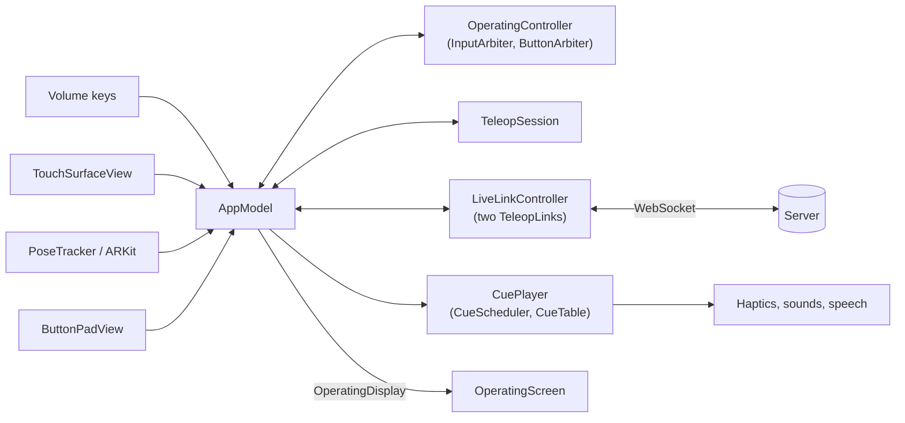

# Architecture

The app turns the iPhone's volume keys, touches on the screen and the phone's own movement into commands for a
robot arm in a simulator, and turns the simulator's answers into vibrations, sounds and speech, so the operator can
work mostly without looking at the screen. This note says where each part lives and how the parts talk. The
messages themselves are in `docs/PROTOCOL.md`; the tests are in `docs/TESTING.md`.

## The layers

| Layer | Where | What it may use | Built and tested by |
|---|---|---|---|
| Core | `Packages/TeleopCore/Sources/TeleopCore` | Foundation and `simd` only: no UI, no sockets, no clock | `swift test` |
| Server model | `Packages/TeleopCore/Sources/TeleopServerModel` | Foundation only | `swift test` |
| Socket host | `Packages/TeleopCore/Sources/TeleopServerHost` | the server model and Network.framework | `swift test` on a Mac |
| App | `App/Sources` | SwiftUI, UIKit, ARKit, AVFoundation, Core Haptics, the core | Xcode |
| App tests | `Tests/TeleopTests` | the app, the core, the server model, the socket host | Xcode |
| UI tests | `Tests/TeleopUITests` | XCUITest, the server model, the socket host | Xcode |

The three package targets are one Swift package (`Packages/TeleopCore/Package.swift`). XcodeGen builds the Xcode
project from `project.yml` (`xcodegen generate`); the project is not committed. Every app file that names a core type
needs `import TeleopCore`.

Everything that decides something lives in the core, where it runs in seconds without a simulator or a phone. The
app target connects it to the device. Nothing in the core reads a clock: `TeleopLink(send:now:)` takes a clock
closure, and the input rules, the feedback and the recorder narration take the time on every call. So a test can
play ten seconds in a millisecond, and the same input always gives the same output. The device parts (haptics,
sound, speech, the socket) sit behind small protocols (`HapticsPlaying`, `SoundPlaying`, `SpeechPlaying`,
`LinkTransport`) that tests replace, and the phone's pose comes in as a closure (`AppModel(pose:)`).

### The core package

| Folder or file | What it is for |
|---|---|
| `TeleopSession.swift`, `FakeTeleopState.swift`, `Route.swift`, `TeleopNavigator.swift`, `BackStackRules.swift`, `HeldControls.swift` | The session: what was asked for (`TeleopAction`), the state the screens and the link follow, and which screen is up. |
| `HapticPattern.swift` | `Haptic`, the vibration patterns the operator feels, and the session's own haptic requests (`HapticCue`, `HapticCommand`). |
| `Input/` | The input rules for the two phone schemes: `InputArbiter` decides what each key press, touch and phone turn means; `SurfaceLayout` gives the screen's zones; `RotationMapper` turns the phone's rotation into a wrist angle; `InputConstants` holds every threshold. |
| `Buttons/` | Buttons mode: `ButtonArbiter` (one button at a time), `ButtonRamp` (the target a held direction button moves), `ButtonPadLayout` (where each button sits), `OperatorFrame` (forward, back, left, right, up and down as robot axes, for the buttons and the phone alike). |
| `Link/` | `TeleopLink`, one conversation with the server: it builds every message, reads every answer and keeps the rules about holds, final acks and resets. `ServerState` reads a `state` message. `WristLeadBound` keeps a wrist command from running ahead of the measured wrist. |
| `Feedback/` | `FeedbackMonitor` turns what the link hears into `FeedbackEvent`s for the hold the operator has engaged; `CueTable` says how each event is felt, heard or spoken; `CueScheduler` decides what plays when two coincide. |
| `Recording/` | `RecorderNarrator` compares successive states and says what happened to each take; `StopExits` decides which ways out of an emergency stop to offer. |

`FakeTeleopState` is the session's real state, despite its name. With `liveLink` set, the connection, the latency
and the emergency stop follow the server. With it off, the app runs **practice**: a built-in demo with no server,
where every press succeeds at once and no message is sent.

### The app target

| Folder | What it is for |
|---|---|
| `TeleopApp.swift`, `AppModel.swift` | The entry point and the one model object. `AppModel` owns the session, the operating controller, the link controller, the cue player and the recorder narrator. Every screen talks to it. |
| `Operating/` | The operating screen's logic: `OperatingController`, `OperatingRules`, `OperatingDisplay`, `GuidePicture`, and `OperatingFixtures` for UI tests. `Operating/Views/` draws it: `OperatingScreen`, `OperatingWords`, `GuideView`, `GuideWords`. |
| `Screens/` | `RootView` (picks the screen from `session.route`; there is no `NavigationStack`), `ConnectScreen`, `SettingsScreen`, `TutorialScreens`, `PermissionsScreen`, `ButtonPadView`. |
| `Components/` | `StopBand` (the STOP band of the other screens), the button styles, `HoldButton`, `PracticeBanner`. |
| `Link/` | `LiveLinkController` (the two sockets and the 30 Hz timer), `LinkTransport` (one WebSocket), and `Guidance.swift`, which holds `RobotProfile`, `PhoneAxes` and `PhonePosture`. |
| `VolumeKeys/` | The volume keys' raw press and release events. |
| `Input/` | `TouchSurfaceView`, a UIKit view that reports every raw touch with its radius and time. |
| `Pose/` | `PoseTracker`: the phone's position and attitude from ARKit world tracking. |
| `Haptics/`, `Audio/` | `CuePlayer`, and the players it drives: Core Haptics patterns, three synthesised sounds, and speech. The players play what they are told and decide nothing. |
| `Localization/`, `Permissions/`, `Theme/` | The in-app language choice, the camera permission request, colours and sizes. |
| `App/Resources/` | The string catalogs (`Localizable`, `Speech`, `Buttons`, `InfoPlist`), each in English and Traditional Chinese. |

## The session and its routes

`TeleopSession` is a value type: the state, the screen stack and the pending haptic requests, changed only by
`perform(_:)`. A route is one entry of the screen stack. Its raw values (`Route.swift`) are identifiers only.

| Route | Drawn by | How the operator gets there |
|---|---|---|
| `s2_permissions` | `PermissionsScreen` | the first launch after an install |
| `t1_tutorial` to `t3_tutorial` | `TutorialScreen` | Continue on the permissions screen, the first time: three pages on the controls of the mode chosen in Settings |
| `p4_standby` | `OperatingScreen` | every later launch; Done in Settings; the end of the tutorial; leaving a stop |
| `p5_connection` | `OperatingScreen` | a connection made from Connect; Back on Connect |
| `p6_high_latency` | `OperatingScreen` | two slow round trips in a row while on `p4_standby` |
| `p7_keyboard` | `OperatingScreen` | only the launch argument `-startRoute` |
| `s4_estopped` | `OperatingScreen` | STOP, or an emergency stop the server reports |
| `s1_connect` | `ConnectScreen` | tapping "Not connected" on the operating screen; Disconnect in Settings; a working link lost on `p4_standby` or `p6_high_latency` while the robot is not stopped |
| `s6_settings` | `SettingsScreen` | a tap on the gear |

The five operating routes look the same: the screen shows the state, not the route. They differ only in what the
session does on them. A lost link opens Connect from `p4_standby` and `p6_high_latency` unless the robot is stopped;
otherwise the operating screen stays and shows Link lost, or STOPPED while the robot is stopped. The app does not
reconnect by itself.

The first time `p4_standby` is reached, the app saves `firstRunDone`, and every later launch opens there.
`-startRoute <raw value>` opens any route, for UI tests.

## The operating screen

`OperatingScreen` is the screen the operator holds while driving. It draws `AppModel.operating`, an
`OperatingDisplay`, and reads nothing else about the link. `AppModel.refreshOperating()` rebuilds that display
whenever something it depends on changes, and writes it only when it differs.

The screen is split into zones by `SurfaceLayout`, from the screen size and safe-area insets:

- **Top band**: the gear (opens Settings) at its left end, the REC line (what the server's recorder is doing), the
  link dot, the mode chip, "Hold to reset", and a countdown bar while the band is held.
- **Control surface**: one state word in a state colour, with detail lines. In the phone modes it also holds the
  guide and the scheme's faint hints; in buttons mode, a state strip and the button pad.
- **Gap**: a strip above STOP where a touch does nothing, so a resting thumb does not stop the robot.
- **Bottom band**: STOP 急停, in every state and every mode.

One `TouchSurfaceView` covers the whole screen, safe areas included, and everything drawn over it lets touches
through. The input rules hit-test the same `SurfaceLayout` rectangles the screen draws, so a band cannot be drawn
in one place and judged in another. Three controls take their own touches: the button pad, **Release, keep scene**
(a one-second hold, shown only in the stopped state when the stop exits offer it), and the "Not connected" word,
which opens Connect. The screen keeps the phone awake while it shows.

What it shows comes from two pure functions in `OperatingRules`:

- `state(_:)` picks one `OperatingState` from the `OperatingFacts` that `AppModel` gathers, highest first: stopped;
  not connected, connecting or link lost; camera stopped; a take just saved (2 s); the hold engaged now (moving,
  turning, tilting, opening, closing); a refusal just heard (1 s); the server resetting or saving; slow link; ready.
  A STOP that has reached no server is not shown as stopped (see "From a press to a message").
  `OperatingWords` turns the state into the word, its details and its colour, in the app's language.
- `arm(_:commanded:gripping:profile:)` builds an `ArmReading` from the newest server state and the robot profile:
  where the jaws pinch, where the arm is being sent during a move, how far the jaws are open, the wrist angles,
  and the target and goal when the server reports them. Practice has no reading.

The **guide** is that reading as a picture: the workspace from above and from behind on one left-right axis, and a
few read-outs under it. `GuidePicture` works out every place and read-out as plain numbers and `GuideView` draws
them. It is shown in the phone modes while Settings → Task aid is on and a reading exists. The target, the goal,
"On target" and "Holding" appear only when the server reports task objects.

`OperatingFixtures` holds a named `OperatingDisplay` for every state; `-operatingFixture <name>` shows one and
nothing overwrites it, so UI tests can photograph each state.

Connect, Settings, the tutorial and the permissions screen are ordinary SwiftUI screens. Each keeps `StopBand`, a
red STOP band that acts on touch-down, along its bottom edge. Settings shows a red STOPPED band at the top while the
robot is stopped.

## The input rules

Settings → Control → Mode picks one of three control modes (`ControlMode`), kept across launches:

| Input | Screen turns (A) | Key turns (B) | Buttons |
|---|---|---|---|
| vol+ held | the arm follows the phone | the arm follows the phone | changes the volume |
| vol− held | the jaws close | the wrist follows the phone's turn or tilt | changes the volume |
| a thumb on the control surface | held while the phone turns: the wrist follows; slid up 10 mm and held: the jaws open | held on the half under the thumb: the jaws close; on the other half: they open; the centre band does nothing | the pad: Forward, Back, Left, Right, Up, Down, Open, Close, and a Fine / Coarse switch |
| the bottom band | STOP, at touch-down | STOP, at touch-down | STOP, at touch-down |
| the top band held 2 s | reset the scene | reset the scene | reset the scene |
| a tap on the gear | Settings | Settings | Settings |

Settings → Hand says which hand holds the phone: scheme B closes on the half under that thumb, and the pad puts
Close on that side. One input at a time: a press that begins while another hold runs is dead until it is released.
A wrist hold commits to one axis, turn or tilt, and follows the phone's rotation on it from where the hold began,
within per-hold limits (`InputConstants.rollClampDeg`, `tiltClampDeg`).

How the raw inputs arrive, all on the main queue:

- **Keys.** `VolumeKeyInput.swift` puts an `AVCaptureEventInteraction` (iOS 17.2 and later) behind the operating
  screen. vol+ is `InputKey.upper`, vol− `InputKey.lower`; began is a press, ended or cancelled a release. They go
  to `AppModel.keyEvent`. iOS delivers them only while the camera is in use, which `PoseTracker`'s ARKit session
  keeps in the phone modes. In buttons mode the camera is off and the keys change the volume.
- **Touches.** `TouchSurfaceView` reports each touch's phase, place, radius and `UITouch.timestamp` to
  `AppModel.touch(_:at:)`. The pad's buttons go to `buttonDown`, `buttonUp` and `selectSpeed`.
- **Phone motion.** `PoseTracker` hands every ARKit frame's camera transform and timestamp to
  `AppModel.poseFrame`, which passes the phone's attitude to the input rules. The link reads the phone's position
  through the `pose` closure for arm holds.
- **Interruptions.** ARKit stopping the camera (`PoseTracker.onInterruption`) and the app leaving the active state
  (`AppModel.activeChanged`) end every hold.

`OperatingController` is the only place where these become commands. It feeds keys, touches, attitude samples and a
30 Hz tick to `InputArbiter` (schemes A and B) and the pad to `ButtonArbiter`, each time with the facts of the
moment from `AppModel.inputFacts()`: whether a start may go out (stopped, no link, Settings open, slow link, server
busy), whether the phone is tracked and held upright, whether the top band may reset, whether the jaws grip, the
measured wrist angles. In buttons mode the input rules still judge the bands. Each command they return becomes a
session action (`model.send`), a link call, or a cue (`model.raise`).

Leaving the operating routes (Settings, Connect, the tutorial), the app leaving the active state, and an ARKit
interruption each end every hold with its stop. An input held across any of them stays dead until it is released.

## From a press to a message

A held vol+ in scheme A:

1. `AppModel.keyEvent(.upper, down: true)` → `OperatingController.key` → `InputArbiter` returns
   `.startTranslation`.
2. The controller calls `model.send(.holdArmStart)`. `TeleopSession.perform` decides: connected, not stopped, not
   blocked by a slow link? Then `armMoving` becomes true and any gripper or wrist hold ends, because the server runs
   one hold at a time. Otherwise the press is refused and the operator hears why.
3. `AppModel.driveLink` compares the state before and after and mirrors the change onto the link: the session
   decides, the link follows. Here it calls `LiveLinkController.startHold`, which notes where the phone is and calls
   `TeleopLink.poseStart`; the `pose_start` text goes to `WebSocketTransport.send`. If the link cannot start (no
   tracked pose, the phone held sideways, a reset pending), the session ends the hold again and the operator hears
   why.
4. `LiveLinkController.tick` runs 30 times a second. During an arm hold it reads the phone's position, smooths and
   scales the movement since the press, turns it into the server's axes and sends `pose_update`. The same tick
   sends keepalives during a gripper hold, the wrist target during a wrist hold, a probe twice a second, and
   anything held back that is now due.
5. Releasing vol+ gives `.stopTranslation` → `.holdArmEnd`; `driveLink` calls `endHold`, which sends `pose_stop`.

The other holds take the same path. A wrist hold sends `.wristStart`, then each new angle goes to
`LiveLinkController.setWristTarget`, and the tick streams it through `WristLeadBound`. A button hold calls
`AppModel.startButtonTranslation`, and the link streams `ButtonArbiter`'s ramp instead of the phone's movement.

STOP sends `.stop`: the session latches the emergency stop and ends every hold, and `driveLink` sends `estop` on
every connection that is up, even when the stop is already latched. With no connection up, nothing reaches the
robot: the operator hears "No link. Not stopped.", the screen shows the link's state instead of STOPPED, and
`estop` goes out first after the next `welcome`.

The top band held 2 s calls `AppModel.runReset`. In the stop state it sends `reset_scene`, and the server's
confirmation releases the stop, unless STOP was pressed again since. **Release, keep scene** releases the stop and
sends `estop_reset`; it is offered, and accepted, only when `StopExits` allows it (no recorder, an unknown server,
or practice).

## The link

`LiveLinkController` keeps two WebSocket connections to the same address, each with its own `TeleopLink`:

- The **control connection** says `hello`, then carries every command: starts, updates, keepalives, stops, `estop`,
  `estop_reset`, `reset_scene`, and a `test` probe twice a second that measures the round trip and keeps the link
  counted as alive. The server sends it `state` only while it sends nothing, so it hears no `state` during a hold.
- The **listening connection** opens after the control connection's `welcome`, says `hello` and then only listens
  (it sends `estop` too when STOP is pressed). The server sends it `state` every 200 ms, holds included. It owns no
  hold, so its closing never stops the robot. If it drops, it opens again 2 s later without a word to the operator.

Every `state` from either connection goes to `FeedbackMonitor` and then to `AppModel` (a state that left the server
earlier than one already handled is dropped). `AppModel` keeps it as `serverState`, for the guide and the operating
state, and hands it to `RecorderNarrator`. The link counts as lost when the socket closes, when no `welcome` comes within 5 s, when the
control connection hears nothing for 2 s, or, while the listening connection is up, when neither hears anything
for 1.2 s.

## From an event to something felt or heard

Four parts raise `FeedbackEvent`s, all through `AppModel.raise`:

- `FeedbackMonitor`, inside the link controller, for the engaged hold: it went live, it was refused, it reached a
  limit, the jaws closed on something, the app or the server ended it, the scene was not reset.
- `RecorderNarrator`, from each `state`: a take saved or discarded, a success, ready, reconnected, the server
  restarted.
- `OperatingController`, for input decisions: a dead press, a refusal and its reason, a wrist limit.
- `AppModel` itself: an emergency stop (from the session's own haptic request), a lost link, a press the session
  ignored, and a practice hold going live at once.

`CuePlayer` asks `CueScheduler` what to play. The scheduler looks the event up in `CueTable` and resolves
collisions: one haptic channel with a fixed priority, one voice with levels, sounds at once. `CuePlayer` gives the
result to `HapticsController`, `SoundPlayer` and `SpeechPlayer`. Spoken words come from the `Speech` string table in
the app's language. The players stay silent in the unit-test host and under the UI tests' `-quietCues YES`; every
cue is still recorded in `AppModel.cueLog`.

## Practice

Practice (Connect → "Practice without a robot", or Settings → Practice) runs the session with `liveLink` off:
nothing is sent to any server, every press succeeds at once, there is no guide, and the operating screen, Connect,
Settings and the tutorial show purple stripes and PRACTICE 練習. It is never saved: every launch is on the real server. `AppModel.startPractice` and `leavePractice`
are the only ways in and out, and both are refused while the emergency stop is latched.

## The safety checker

The safety checker in `.cursor/skills/verify-session-safety/` imports the real `TeleopCore`, starts from every way
the app can open, and tries every action in every reachable state of `TeleopSession`. It checks a list of
promises, for example: the emergency stop stays latched until it is released on purpose or a reset asked for in the
stop state is confirmed; the arm, the gripper and the wrist move only while connected, not stopped and not blocked
by a slow link; releasing a control always stops it; at most one hold is active; while stopped, every screen the
operator can be on shows it. One set of promises (S) must hold for any sequence of actions; another (U) for the
actions the shipped screens can send, which `ui-map.tsv` lists per route. Its `SKILL.md` lists every promise and
what is left out.

Run it from the repository root:

    .cursor/skills/verify-session-safety/scripts/check.sh

It needs `swift` and `python3`. Exit 0 means every promise holds (or is a listed known finding); 1 a new violation,
a stale known finding or drift between the checker's tables and the code; 2 that `swift` is missing (a skip, not a
pass). For a violation it prints the shortest sequence of actions from launch that breaks the promise.

Update it before a change counts as safe:

- when a `TeleopAction` is added: add it to the checker's action table and, if a screen sends it, to `ui-map.tsv`;
- when a stored field is added to `FakeTeleopState`: add it to the checker's state key, or to its list of fields
  no action changes;
- when a screen gains or loses a control that sends an action: update its row in `ui-map.tsv`;
- when a covered file changes: read the change, confirm the checker still describes the code, and move the sync
  commit in `SKILL.md`.

`drift.py`, run by `check.sh`, fails when one of the first three is forgotten. For the fourth, `check.sh` prints a
`REVIEW` line for each covered file that differs from the sync commit. That is a reminder, not a failure. The sync
commit is older than much of the app, so a clean checkout prints many of them; look at the ones for files your own
change touched.

## Where robot and task numbers live

`RobotProfile` (`App/Sources/Link/Guidance.swift`) holds what the app must know about one robot setup:

| Field | What it is |
|---|---|
| `toolOffset` | from the point the server reports for the arm to where the jaws pinch, in the robot base frame |
| `baseInWorld` | where the robot base sits in the world frame (the server reports objects in the world frame) |
| `graspTolerance` | how close the pinch point must be to the target's centre to count as on target |
| `targetSize`, `goalSize` | the task object's and the goal area's size across, for drawing them true to size |
| `gripperOpenDeg`, `gripperEmptyDeg` | the measured jaw angles that count as fully open and as closed on nothing |
| `workspaceMin`, `workspaceMax`, `tableHeight` | the box the server keeps the pinch point in, and the table's height, for the guide |
| `rollSign`, `tiltSign` | which way a turn or a tilt of the phone moves the wrist; both +1 until a check on the live robot sets them |
| `recloseLoosensGrip` | a second close while gripping is refused, because on this robot it loosens the grip |

`RobotProfile.so101Simulator` is the one profile. The input rules' thresholds are in `InputConstants`
(`profile.inputConstants` adds the profile's wrist signs). A few numbers that come from the server's rules sit next
to the code that uses them: the 8 cm cap per server hold and the 1.5 s resync (`LiveLinkController`), the ranges the
server accepts for `pose_start` (`PoseParams`), and the buttons' speeds (`ButtonSpeed`).

## The server model used by tests

`TeleopServerModel` is a deterministic model of the server: its message rules and a small simulated world (the arm
as a point, the task object, the goal, the table), with time passed in. `ServerModelConfig` holds every number it
uses, each with its source. `LocalTeleopServer` (`TeleopServerHost`) serves the model on a real WebSocket at
127.0.0.1, at a port the system picks, so app and UI tests connect the real app to it.
`Tests/TeleopTests/ServerModelProfileTests.swift` fails when the model and the robot profile disagree on the
numbers both have (the tool offset, the base position, the grasp tolerance, the object and goal sizes, and a start
with the jaws side by side). `docs/TESTING.md` says how the model is checked against recordings of the real server.
